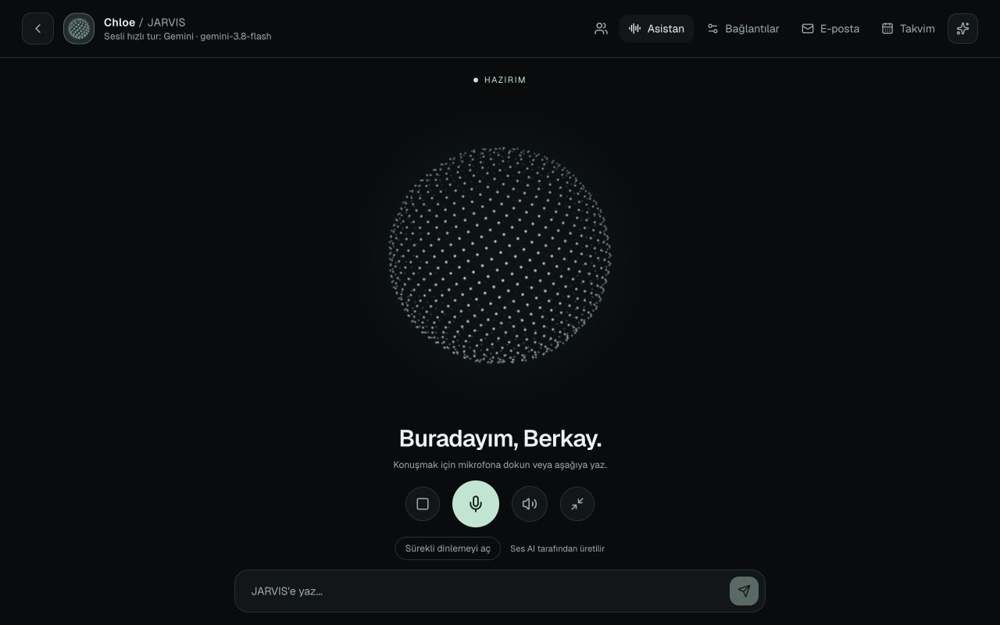
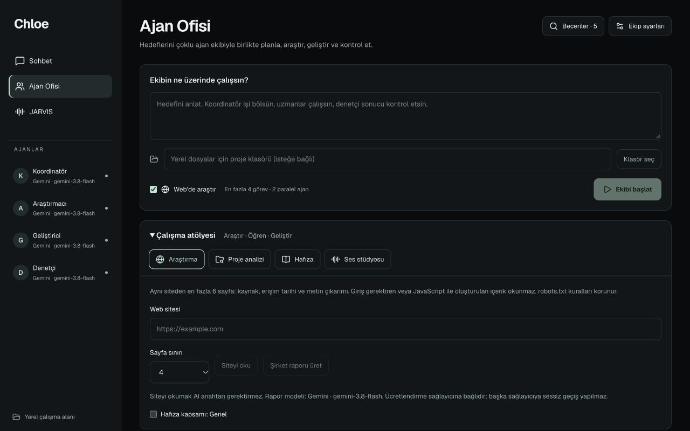
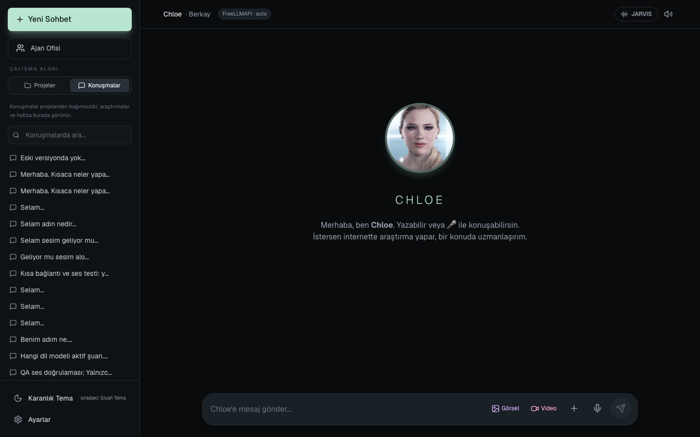
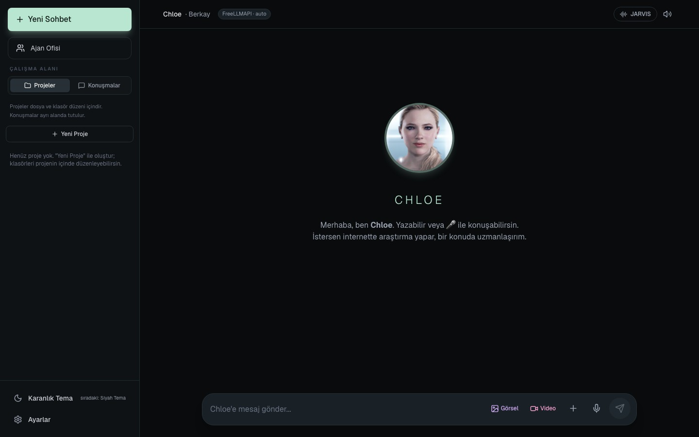

<div align="center">

# ✦ Chloe Assistant

### Your Intelligent Personal AI Workspace · Powered by Any Model · Native on macOS

[](https://apple.com)
[](https://nextjs.org)
[](https://www.typescriptlang.org)
[](#guvenlik)
[](https://github.com/BerkayAtag/chloe-assistant/releases/tag/v0.2.6)

<br/>

**[📦 İndir (v0.2.6 · kaynak + kurucu)](https://github.com/BerkayAtag/chloe-assistant/releases/tag/v0.2.6)** ·
**[🚀 Hızlı Kurulum](#kurulum)** ·
**[🎙️ JARVIS & Ses](#jarvis)** ·
**[👥 Ajan Ofisi](#ajan-ofisi)** ·
**[💻 Chloe Code](#chloe-code)** ·
**[🔒 Güvenlik](#guvenlik)**

<br/>

<a href="#jarvis">
  
</a>

<p align="center"><em>Chloe JARVIS Modu — Sesli sohbet, reaktif parçacık küresi, ses akışı ve onaylı ekip yönetimi. Görsel uygulamanın gerçek ekranıdır.</em></p>

</div>

---

## 🌟 Öne Çıkan Özellikler

Chloe; günlük sesli yapay zekâ asistanlığını, derin web araştırmasını ve projeler üzerinde çalışan otonom ajan ekiplerini tek bir güvenli, yerel öncelikli macOS ve web çalışma alanında bir araya getirir.

<table width="100%">
<tr>
<td width="50%" valign="top">

### 🎙️ JARVIS Sesli Asistan & Hızlı Sohbet
- **Cihaz içi ve Bulut Ses:** macOS seslendirmesi veya seçtiğiniz API'nin doğal sesi. Bulut modelinin yanıt süresi ayrıca beklenir.
- **Akışlı Ses Üretimi:** İlk uygun cümlede sentez istenir. Gemini PCM akışı, tüm ses dosyası hazır olmadan oynatılır; ağ/model beklemesi devam edebilir.
- **Konuşurken Ekip Yönetimi:** Konuşma kesilmeden kodlama işleri başlatılabilir, durum raporları sesli dinlenebilir veya ekranda görüntülenebilir.
- **FreeLLMAPI Hızlı Yönlendirme:** Uyumlu `auto` bağlantılarında `auto:fast`; sabit model ve ayrı Jarvis bağlantısı seçimi korunur. Hız sağlayıcı yüküne bağlıdır.
- **Kontrollü mikrofon:** Ara tanıma sonuçlarında konuşma kesilmez. Otomatik gönderimi kapatıp uzun komutun sonunda **Bitir ve gönder** kullanabilirsiniz.

</td>
<td width="50%" valign="top">

<a id="ajan-ofisi"></a>
### 👥 Ajan Ofisi (Ekip Çalışması)
- **Rol Odaklı Ajanlar:** Koordinatör, Araştırmacı, Geliştirici ve Denetçi eş zamanlı işbirliği yapar.
- **Güvenli Dosya İnceleme Kapısı:** Değişiklikler doğrudan dosyalara yazılmaz; önce incelenir, onaylanır ve gerekirse tek tıkla uygulanır.
- **Çalışma Atölyesi:** Kapsamlı web araştırması, yerel proje mimari analizi, kalıcı hafıza bankası ve ses üretim stüdyosu.

</td>
</tr>
<tr>
<td width="50%" valign="top">

<a id="chloe-code"></a>
### 💻 Chloe Code Workspace
- **Proje Gezgini & Düzenleyici:** Yerel proje dizinini seçin, dosyaları tarayın ve yerleşik editörde düzenleyin.
- **Yapay Zekâ Destekli Değişiklik Önerileri:** Seçili modelden diff ve öneri alın, versiyon çakışmalarını önleyin.
- **Yerel Proje Denetimleri:** Test, lint ve build komutlarını süre ve çıktı sınırlarıyla güvenle koşturun.

</td>
<td width="50%" valign="top">

### 🔒 Yerel Öncelikli Güvenlik Mimarisi
- **Şifreli Anahtar Kasası:** Anahtarlar diskte AES-256-GCM ile saklanır ve Git paketine alınmaz. Yetkili yerel arayüz kullanım sırasında etkin anahtarı bellekte tutar.
- **Katı SSRF ve Origin Koruması:** Dış sitelerin yerel ağa erişmesi ve kontrolsüz kaynak indirmesi engellenir.
- **Açık Onay Prensibi:** Dosya değiştirme, komut yürütme ve e-posta gönderimi açık kullanıcı onayı olmadan çalışmaz.

</td>
</tr>
</table>

---

## 📸 Uygulama Galerisi

<div align="center">

### 👥 Ajan Ofisi — Çoklu Ajan Koordinasyonu ve Çalışma Atölyesi


<br/><br/>

### 💬 Chloe Ana Sohbet — Sade, Hızlı ve Akıllı Arayüz


<br/><br/>

### 💻 Chloe Code — Yerel Proje ve Dosya Düzenleyici


</div>

---

## ⚡ Tepki Süresi ve FreeLLMAPI Hızlandırma Rehberi

Chloe uygulamasında konuşma yanıt süresini maksimum hıza çıkarmak için aşağıdaki optimizasyonlar entegre edilmiştir:

1. **FreeLLMAPI Hızlı Modu (`auto:fast`):**
   - FreeLLMAPI üzerinde varsayılan `auto` seçimi ağır düşünme modellerine yönlenebilir.
   - Uyumlu FreeLLMAPI bağlantısında `auto`, hızlı sesli tur için `auto:fast` olur. Alt modeli gateway seçer; Chloe zorunlu olarak Gemini'ye geçmez.
   - Sabit model isterseniz bağlantınızın güncel model listesinden seçin. Jarvis hızlı yanıtı ve ses sentezi için ayrı bağlantılar da tanımlanabilir.

2. **Cihaz Sesi (Çevrimdışı macOS Motoru):**
   - **Jarvis ayarları → Cihaz sesi** seçildiğinde bulut ses sentezi beklenmez; yüklü macOS sesi kullanılır. Sesin doğallığı seçilen sistem sesine bağlıdır.

3. **Akışlı Cümle Kuyruğu:**
   - İlk uygun cümle/bölüm gelir gelmez sentez istenir; sonraki bölüm paralel hazırlanır. Bu, bütün yanıtı beklemeyi kaldırır ancak bir saniyenin altında yanıt garantisi değildir.
   - Gemini doğal sesinde 24 kHz PCM parçaları doğrudan oynatıcıya aktarılır. Uyumlu özel API'lerin MP3/WAV yolu korunur.
   - Kota, yanlış anahtar ve yapılandırma hataları cümle başına tekrar denenmez; açık hata ile durur. Sağlayıcı otomatik değiştirilmez.

4. **Konuşma sonu kontrolü:** Varsayılan sessizlik eşiği 2,5 saniyedir. Daha hızlı teslim için **Bitir ve gönder**; uzun talimatlar için otomatik gönderimi kapatın. Ekrandaki ilk metin/ilk ses ölçümleri sağlayıcı beklemesini ayırır.

---

<a id="jarvis"></a>
## 🎙️ JARVIS: Sesli Asistan & Ekip Yönetimi

JARVIS modunu açtığınızda hem konuşabilir hem de tüm yönetim ve kodlama işlerini sesli veya yazılı komutlarla yürütebilirsiniz:

- **Kodlama Yap:** *"Kodlama yap"*, *"Projemdeki hataları düzelt"* veya *"Yeni bir fonksiyon yaz"* dediğinizde Ajan Ofisi görevi hazırlar; onayınızla ekip çalışması başlar.
- **Rapor İsteme:** *"Rapor sun"*, *"Raporu oku"*, *"Ekibin durumu ne?"* veya *"Durum raporu ver"* dediğinizde çalışan ekibin anlık durumu hem seslendirilir hem de iş panelinde tam Markdown raporu olarak sunulur.
- **Bilgisayar Yönetimi:** *"Terminali aç"*, *"Hesap Makinesini aç"* gibi komutlar önce öneri olarak hazırlanır ve macOS güvenlik onay penceresine iletilir.
- **Web ve Tarayıcı:** *"example.com sitesini aç"* dediğinizde yerel macOS tarayıcı penceresinde güvenli sayfa önizlemesi açılır.

**Hangi model yanıtlıyor?** Sesli hızlı tur ayrı Jarvis bağlantısını kullanabilir; yazılı/araçlı turlar ana bağlantıyı kullanır. Yanıt sırasında sunucunun gerçekten seçtiği bağlantı **Son yanıt / Yanıt bağlantısı** alanında gösterilir; ses sentezi ayrıca yapılandırılabilir.

---

<a id="kurulum"></a>
## 🚀 Hızlı Kurulum & Download

### Gereksinimler
- **macOS:** macOS 15+ (Sequoia veya daha yenisi)
- **Node.js:** v22.0.0 veya daha yenisi
- **Komut Satırı Araçları:** Apple Command Line Tools (`xcode-select --install`)

### 1. İndirme Paketi (GitHub Releases)
En güncel sürüm paketini indirin:
👉 **[Chloe v0.2.6 İndir (.zip)](https://github.com/BerkayAtag/chloe-assistant/releases/tag/v0.2.6)**

Paketi kalıcı bir klasöre çıkarın ve klasör içindeki **`Install Chloe.command`** dosyasını çift tıklayarak çalıştırın. Kurucu bağımlılıkları derler ve uygulamayı `/Applications/Chloe.app` konumuna kurar.

Paket **kaynak kod + yerel kurucu** içerir; taşınabilir, Apple notarizasyonlu bir `.app` değildir. Kaynak klasörünü kurulumdan sonra silmeyin/taşımayın. Özel depoda indirmek için GitHub erişiminiz gerekir. Güncellemeler aynı uygulama yoluna kurulur; önceki sürüm ZIP yedeği olarak korunur, anahtar kasası silinmez.

### 2. Kaynak Koddan Kurulum

```bash
# Depoyu klonlayın
git clone https://github.com/BerkayAtag/chloe-assistant.git
cd chloe-assistant

# Bağımlılıkları yükleyin
npm ci

# Uygulamayı derleyin ve MacBook'unuza kurun
./script/build_and_run.sh --verify
```

Derleme tamamlandığında **Finder → Uygulamalar → Chloe** açılarak kullanıma hazır hale gelir. Arka plandaki yerel servis `http://127.0.0.1:3004` adresinde çalışır.

---

## 🧪 Test & Kalite Güvencesi

19 Ekim kontrolü: **174 birim/regresyon + 108 izole API kontrolü + 4 native komut kontrolü geçti.** Gerçek kayıtlı bağlantıyla kod üretme/kaydetme/çalıştırma (8 kontrol) ve ekip → denetim → açık uygulama → çalıştırma da geçti. Canlı model yanıtı deterministik değildir; eksik veya kesilmiş çıktı başarı sayılmaz.

```bash
# Çekirdek testler (Runtime, Voice UI, JARVIS, Bağlantılar, Skills, Codex, Workbench)
npm run test:runtime
npm run test:voice-ui
npm run test:jarvis
npm run test:pcm
npm run test:office-plan
npm run test:connections
npm run test:skills
npm run test:codex
npm run test:workbench

# API testleri (Ofis/Atölye için izole veri dizinli QA sunucusu kullanın;
# mevcut kullanıcı ekibini test verisiyle değiştirmeyin)
npm run test:jarvis-api
npm run test:jarvis-key
npm run test:codex-api
npm run test:office
npm run test:workbench-api

# Statik tip ve lint kontrolü
npx tsc --noEmit
npm run lint

# İsteğe bağlı gerçek sağlayıcı testleri: API kotası tüketebilir.
# Yalnızca geçici test klasörlerinde kod üretir/yazar/çalıştırır.
npm run test:code-e2e
npm run test:team-e2e
```

18–19 Ekim doğrulaması ve bilinen sınırlar: [Release History](RELEASE-HISTORY.md#v026--2026-10-19).

**Canlı ses testi sınırı:** 19 Ekim'de kullanılan Google ücretsiz TTS kotası HTTP 429 döndürdü. PCM protokolü ve oynatma/iptal regresyonları test edildi; son düzeltmeden sonra gerçek sağlayıcı + hoparlör zinciri kota yenilendiğinde yeniden denenmelidir. Hiçbir sürüm notu tüm sağlayıcıların her zaman yanıt vereceği anlamına gelmez.

---

<a id="guvenlik"></a>
## 🔒 Gizlilik & Güvenlik

- **Veri akışı:** Modeli kullanırken mesaj ve seçili dosya bağlamı yapılandırdığınız sağlayıcıya gider. Konuşma tanıma Apple/tarayıcı hizmetini kullanabilir; bulut seslendirme metni ses sağlayıcısına gönderir.
- **Ayrık Veri Saklama:** Ana bağlantı kasası macOS'ta `~/Library/Application Support/Chloe/connections` altındadır. Ajan kasası `data/office` içindedir. Sohbet/yerel dosyalar anahtar kasası gibi şifrelenmiş sayılmaz; `.gitignore` özel verileri dağıtımdan dışlar.
- **İnternet Güvenlik Sınırı:** Tarayıcı ve araştırma modülleri döngüsel (loopback) ve özel yerel ağ adreslerine erişemez (SSRF koruması).
- **Yerel sunucu:** Desteklenen `npm run dev`, `npm start` ve native açılış yolları `127.0.0.1` dinler. Host/Origin kontrolleri kimlik doğrulama değildir; sunucuyu internete açmayın veya ağ arayüzünü geçersiz kılmayın.
- **Yedekleme:** Önceki uygulama `~/Library/Application Support/Chloe/app-backups/` altında ZIP olarak korunur. Derleme kopyası `.build.noindex` içindedir; Spotlight'ta ikinci bir uygulama oluşturmaz.
- **Sınır:** Onaylanmış proje komutları hesabınızın yetkileriyle çalışır; kötü niyetli proje koduna karşı bir işletim sistemi sandbox'ı değildir. Denetim sıfır açık garantisi vermez.

---

<div align="center">

**Chloe Assistant** · Geleceğin kişisel yapay zekâ asistanı deneyimi.

[Yukarı çık ↑](#-chloe-assistant)

</div>
